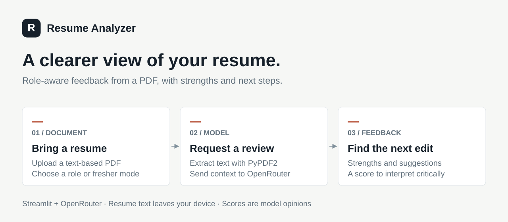

<div align="center">

# Resume Analyzer

**Practical resume feedback, tailored to a role.**

Upload a PDF, add context, and review strengths and improvements in one place.

[Quick start](#quick-start) · [Configuration](#configuration) · [How it works](#how-it-works) · [Contributing](#contributing)

</div>



A focused Streamlit app that extracts resume text with PyPDF2 and requests structured feedback through OpenRouter. Add a target job role or select fresher mode to tailor the review.

**Project status:** educational prototype. The “ATS score” is generated feedback, not a measurement from an applicant tracking system.

## Features

- Extract text from PDF resumes with PyPDF2.
- Request strengths, weaknesses, practical improvements, and a summary.
- Tailor the prompt to a target role and entry-level applicants.
- Display the response as Markdown in Streamlit.

## Quick start

Use Python 3.10+ and an OpenRouter API key with access to the configured model.

```sh
git clone https://github.com/mukheshvadlamudi/Resume-analyser.git
cd Resume-analyser
python -m venv .venv
```

Activate with `.venv\Scripts\Activate.ps1` in PowerShell or `source .venv/bin/activate` on macOS/Linux, then install:

```sh
python -m pip install -r requirements.txt
```

Create `.streamlit/secrets.toml` locally:

```toml
OPENROUTER_API_KEY = "replace_with_your_key"
```

Keep that file out of Git. The included `.gitignore` excludes local secrets and virtual environments; check staged files before committing.

```sh
python -m streamlit run resume_analyzer_openrouter.py
```

Open the address printed by Streamlit, usually [http://localhost:8501](http://localhost:8501). Upload a text-based PDF and optionally enter the target job role. Uploading a readable resume triggers the review; changing inputs can trigger another request.

## Configuration

| Setting | Location | Current value |
| --- | --- | --- |
| API key | `.streamlit/secrets.toml` | `OPENROUTER_API_KEY` |
| Model | `MODEL` in `resume_analyzer_openrouter.py` | `meta-llama/llama-3-8b-instruct` |
| Response limit | `MAX_TOKENS` in the same file | `1000` |

The model identifier is hardcoded. If OpenRouter reports that it is unavailable, change `MODEL` to an identifier supported by your account. Requests can incur provider charges.

## How it works

1. PyPDF2 extracts readable text from the uploaded PDF.
2. The app builds a prompt using that text, the optional target role, and fresher mode.
3. OpenRouter returns model-generated strengths, weaknesses, suggestions, and a score.
4. Streamlit displays the response as Markdown for the user to review.

This app calls OpenRouter directly from the Streamlit Python process. There is no separate API server, document database, or retrieval layer.

All application logic is in [resume_analyzer_openrouter.py](resume_analyzer_openrouter.py); dependencies are in [requirements.txt](requirements.txt).

## Limitations and privacy

- The extracted resume text and role are sent to OpenRouter and its selected model provider. Use a redacted resume when trying the app.
- Scanned image-only PDFs require OCR, which is not implemented.
- Feedback and scores are model opinions and require human judgment.
- The HTTP request has no explicit timeout or retry policy. Network failures can interrupt a review.
- There is no automated test suite or production authentication layer.

## Contributing

Report issues with a redacted example and reproduction steps. Keep changes small and verify PDF extraction, the no-readable-text case, and provider error handling. Never commit API keys or real resumes. OCR, request timeouts, and tests are useful improvements.

## License

No project license is included. The owner must choose reuse terms before this can be presented as an open-source release.
